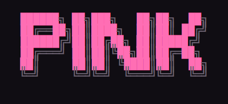
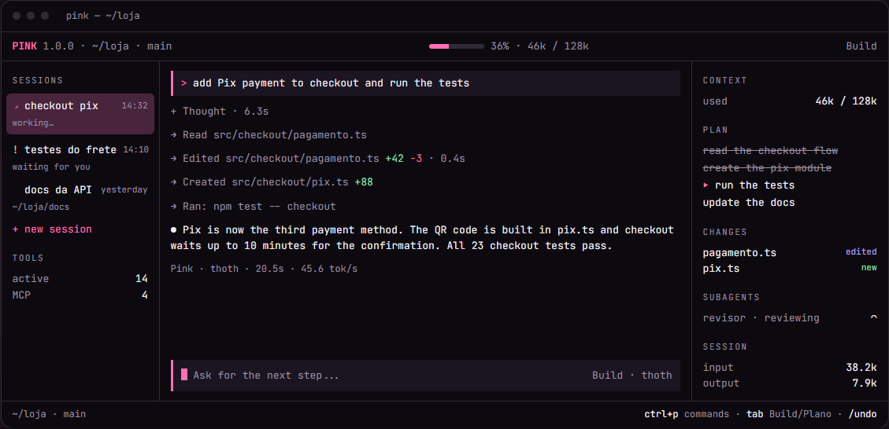

<p align="center">
  
</p>

<p align="center">
  <b>The coding agent for your terminal that works where you can see it.</b><br>
  Plan, changed files and context on screen, many sessions side by side, a real undo,
  and the agents you already pay for, all in one place.
</p>

<p align="center">
  <a href="https://www.npmjs.com/package/@thothdev/pink"></a>
  <a href="LICENSE"></a>
  <a href="https://pink.thothdev.ia.br"></a>
</p>

<p align="center">
  
</p>

## Install

```bash
npm install -g @thothdev/pink
```

Then run `pink` inside your project folder. Needs Node.js 22.19 or newer.

```bash
pink                                # interactive session
pink -p "explain this repository"   # one-shot answer
pink --help
```

## What only Pink does

| | |
|---|---|
| **Use the agents you already have** | `/agente claude`, `/agente codex`, `/agente opencode`... hands the session to Claude Code, Codex, opencode, Gemini, Qwen, Cline, Goose or Copilot, with their own login and plan. No new API key. A menu picks the model; `/agente off` comes back. |
| **Your rules come along** | The chosen agent gets Pink's MCP servers, `AGENTS.md` and skills, and can call Pink itself as an MCP tool (`pink_tarefa`). |
| **Sees and uses your screen** | On Windows, `/tela ligar` lets the agent see your windows and click or type in them. Seeing never asks; every click asks for your OK, and typing into a terminal asks twice. Off by default. |
| **Sessions side by side** | Each session runs in its own process in the left sidebar. If one hangs, the others keep going. A spinner shows who is working and `!` who is waiting for you. |
| **A real `/undo`** | Rolls back the last message, the replies and the file changes, and puts your text back in the box, without touching your git index, stash or commits. |

## Everything else

- **Build and Plan agents.** `tab` on an empty box switches. Plan only reads and plans: it asks before running a command and never edits files.
- **Subagents.** The `subagent` tool hands work to a separate `pink` process, alone, in parallel or in a chain. Custom agents live in `~/.pink/agent/agents/*.md`.
- **Guard before danger.** Destructive commands ask first; `.env`, `.git` and keys are protected. Rules go in `permissions.json` (`allow` / `ask` / `deny`), and hooks in `hooks.json` use the Claude Code format.
- **MCP and the web.** `/mcp` connects MCP servers. `web_search` and `web_fetch` work with no key and no extra server.
- **Compact transcript.** Each read, edit and command becomes one short line. `ctrl+o` opens the full tool output with the diff, `ctrl+t` opens the thinking.
- **Adapts to the width.** Three columns from 150 columns up, two from 115, just the conversation below that.
- **Questions with options**, a todo list in the sidebar, and a system notification when an answer finishes while the window is in the background.

## Keys and commands

| Key / command | What it does |
|---|---|
| `ctrl+p` | Command palette (also `/help`) |
| `tab` (empty box) | Switch between Build and Plan |
| `f2` / `shift+f2` | Next / previous model |
| `ctrl+t` / `ctrl+o` | Open thinking / full tool output |
| `ctrl+n` | New session |
| `/agente [name] [model]` | Talk to an installed agent; `/agente off` returns to Pink |
| `/tela ligar` | Let the agent see and use the screen (Windows) |
| `/undo` / `/redo` | Undo / redo the last message and its file changes |
| `/sessions`, `/themes`, `/mcp` | Switch session, pick a theme, manage MCP servers |
| `/lateral` | Hide or show the side columns |

## Configuration

- Settings live in `~/.pink/agent/` (or `$PINK_CODING_AGENT_DIR`) and in `.pink/` inside the project. Environment variables start with `PINK_`.
- Providers and models: `~/.pink/agent/models.json` (see `docs/models.md`).
- No sidebar of sessions: `pink --sem-sessoes` or `PINK_NO_MUX=1`. The sidebar needs the optional `node-pty`; without it Pink runs as a single session.
- Plain look without Pink's interface: `PINK_NO_BUILTIN_UI=1 pink --tui-mode regular`.

## Thoth in the sidebar (optional)

If [Thoth](https://thothdev.ia.br) runs on the same machine, the right column gets a **THOTH** section with the approvals waiting for you, the card in progress for this folder and the model that answered the last Thoth gateway call. It only reads, in the background, every 30 seconds. Without Thoth the section says it is unavailable and Pink works as usual.

## Privacy

Pink sends no install telemetry and checks no versions on third-party servers. What leaves your machine is what you send to your model provider.

<details>
<summary><b>Pink colors in Windows Terminal</b></summary>

Pink uses your terminal's background. For the dark `#100d13` of the screenshots, add this scheme to `"schemes"` in Windows Terminal's `settings.json` and pick **Pink** under Profile → Appearance → Color scheme.

```json
{
    "name": "Pink",
    "background": "#100D13",
    "foreground": "#F2EDF4",
    "cursorColor": "#FF6EB4",
    "selectionBackground": "#49243D",
    "black": "#17131B",
    "red": "#E05555",
    "green": "#8DE0B1",
    "yellow": "#F0C487",
    "blue": "#6AA6F8",
    "purple": "#B7A4FF",
    "cyan": "#56C2C9",
    "white": "#D7CEDB",
    "brightBlack": "#6B6170",
    "brightRed": "#FF6E8A",
    "brightGreen": "#A8F0C6",
    "brightYellow": "#FFD9A3",
    "brightBlue": "#8FBCFF",
    "brightPurple": "#FF9BCE",
    "brightCyan": "#7FDDE3",
    "brightWhite": "#F2EDF4"
}
```

</details>

## Building from source

The fork is a reproducible patch (`rebrand.json`) over a pinned upstream tarball, not a copy of its code:

```bash
python -X utf8 build_pink.py --out out   # builds out/thothdev-pink-<version>.tgz
npm install -g out/thothdev-pink-*.tgz
```

## License

Pink is a fork of [Pi](https://github.com/earendil-works/pi-mono) (MIT, copyright (c) 2025 Mario Zechner): the agent loop, providers, terminal UI, sessions and compaction come from it, with Pink's own interface, theme and extensions on top.
License: MIT (see `LICENSE`); the upstream license is in `LICENSE-PI.txt`, and `NOTICE.md` lists what changed.
